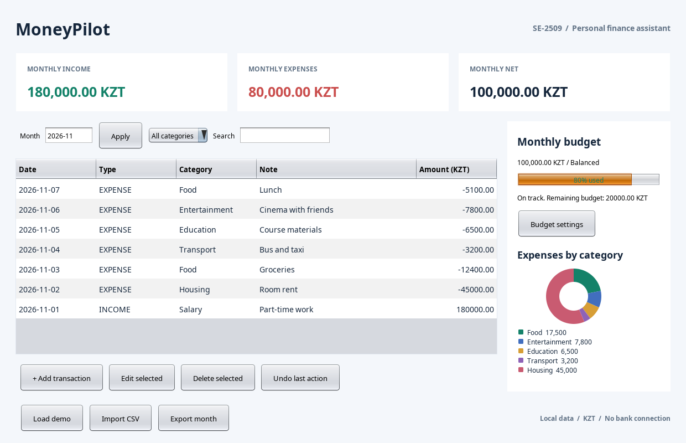

# MoneyPilot
Personal finance assistant for the Software Design Patterns final project.

**Manyakina Yuliya, Bazarbayev Bakdaulet | SE-2509 | Astana IT University**

## Run
Install Java 17 or newer, unzip the complete project, then double-click `run.bat` on Windows. On Linux/macOS use `sh run.sh`. You can also run `java -jar MoneyPilot.jar`. The prebuilt JAR has no external dependencies. A desktop environment is required.

To rebuild with a JDK 17+: `build.bat` or `sh build.sh`.
To run the regression checks: `test.bat` or `sh test.sh`.

## Features
- Add, edit and delete income and expenses in KZT.
- Choose a month, filter by category, search notes and sort the table.
- Monthly income, expenses, net cash flow and expense category chart.
- A global monthly budget with Balanced (100%) or Cautious (80%) warning threshold.
- Undo transaction changes, including an imported batch, during the current session.
- Import/export a semicolon CSV with quoted fields. No real bank integration.
- Local persistence. The app starts empty; Load demo appends fictional records to the selected month.

Dashboard totals and chart always cover the entire selected month. Category/search filters only change the table. Monthly net means income minus expenses for that month, not a bank account balance. The same budget setting applies to every month. Changing settings cannot be undone. Importing the same CSV twice adds another copy.

## Six patterns and suggested defense responsibilities
| Pattern | Classes | Presenter |
| --- | --- | --- |
| Builder | Transaction.Builder | Manyakina Yuliya |
| Observer | EventBus, FinanceListener, BudgetAlert, DashboardPanel | Manyakina Yuliya |
| Adapter | TransactionImporter, LegacyBankAdapter, LegacyBankCsv | Manyakina Yuliya |
| Strategy | BudgetStrategy.Balanced, BudgetStrategy.Cautious | Bazarbayev Bakdaulet |
| Command | TransactionCommand, CommandHistory | Bazarbayev Bakdaulet |
| Facade | MoneyPilotFacade | Bazarbayev Bakdaulet |

This is a preparation split. Each student should review and practise their assigned classes before claiming individual implementation at the defense.

## Data and CSV
Data is stored at `<user.home>/.moneypilot/data.properties`. To use an isolated demo file:
`java -jar MoneyPilot.jar demo-data.properties`
Close the app before copying/removing its data file. Only run one instance against a given data file. No encryption, user accounts or cloud synchronization.

CSV header: `date;amount;category;note`. ISO date. A negative amount is an expense, positive is income. Zero and amounts with more than two decimal places are invalid. Categories match the names in Transaction.CATEGORIES. Notes are one line, up to 180 characters. Double quotes escape as `""`; use quoted fields for semicolons. The sample is dated November 2026. Use month `2026-11` to see it. CSV export includes the full selected month regardless of table filters.

Import validation is all-or-nothing. Undo reverses the whole batch. Exporting then reimporting appends records; it does not merge them by ID.

## Project structure
`src/moneypilot/`: Java application and six patterns.
`test/moneypilot/ProjectTest.java`: headless regression checks.
`test/moneypilot/RenderScreenshots.java`: offscreen rendering of the actual Swing panel for documentation.
`docs/screenshots/`: rendered application views with fictional demo data.
`docs/uml/`: UML source and rendered diagrams.
`samples/bank-demo.csv`: legacy import example.

## Validation
35 executable checks passed on OpenJDK 21 with Java 17 target bytecode. Checks cover amounts, monthly totals, categories, both policies, notifications, unsubscribe, add/edit/delete undo, CSV escaping, failed import, disk reload, corrupt data, disk failure and Swing filtering/undo. Documentation screenshots render the actual Swing components offscreen. They are not captured from a live desktop session. Manual native file chooser and Windows double-click behavior still need local verification.

## Limits and future work
This is an educational, single-user bookkeeping app. It does not connect to Kaspi or another bank, predict investments or make payments. Future work: per-month budgets, category limits, database storage, account encryption and automated import deduplication. The app performs file work on the Swing event thread, so very large files can briefly freeze the window.

## Submission
The separate delivery includes a PDF report with UML, screenshots and the complete Java source appendix; a PPTX presentation; individual preparation guides; and an eight-minute speaking script. Source code is provided in ZIP format.
